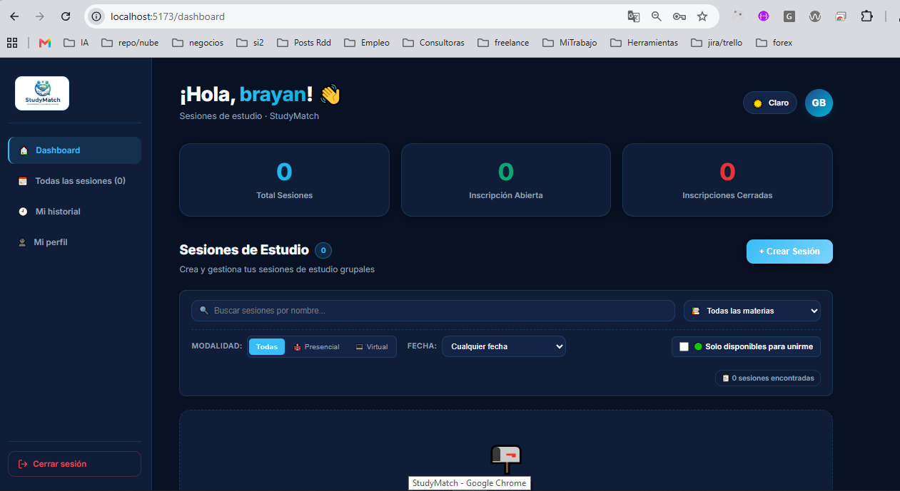

## proyecto recibido: 
Calani Garcia Fernando Javier
https://github.com/FernandojCg737/2do_Proyeccto_IHC


## Recorrido

Seguimos el caso de un estudiante que se inscribe en una sesión de estudio creada por otra persona. Es el recorrido existente más cercano a la tarea 5, que propone solicitar la unión y esperar la respuesta del organizador.

En la diapositiva se usaban como ejemplo `PlanDetail`, `handleVote()`, `canVote()` y `votesRepository`. Esos nombres no corresponden a StudyMatch. Aquí el recorrido real es el siguiente.

La pantalla es el Dashboard, en `frontend/src/pages/Dashboard.jsx`. En las tarjetas de las sesiones, el botón **Inscribirme** guarda la sesión seleccionada y abre un diálogo de confirmación. El diálogo muestra información como la materia, fecha, modalidad y cupos; al confirmar, llama a `handleConfirmJoin`.

En el mismo archivo, `handleConfirmJoin` llama a `handleJoinSession`. Esta función comprueba en la interfaz que la sesión no esté cerrada y envía `POST /sessions/{id}/join` mediante el cliente de `frontend/src/api/axios.js`. El cliente usa la dirección `http://localhost:8000` y adjunta el token del usuario cuando existe. Si la petición sale bien, el Dashboard actualiza la sesión mostrada y presenta un mensaje de inscripción; si falla, muestra el error recibido.

La ruta está en `backend/app/routers/sessions.py`, en la función `join_session`. Obtiene la sesión por su identificador y exige un usuario autenticado. Si no encuentra la sesión, responde con un error 404. Después llama a `register_participant` con el correo del usuario; si la regla rechaza la operación, responde con un error 400.

La regla está en `backend/app/models.py`. La función `can_join` comprueba que la sesión esté abierta, que la fecha no haya pasado, que el usuario no sea el creador, que no esté inscrito y que haya cupos disponibles. Si se cumplen las condiciones, `register_participant` agrega el correo y actualiza la cantidad de participantes. La inscripción es directa: actualmente no espera una aceptación o rechazo del organizador.

Los datos se guardan en PostgreSQL. En el modelo `Session`, del mismo archivo, `participant_emails` almacena los correos de los participantes y `participants_count` su cantidad. La ruta también registra un evento `unido` en el historial y ejecuta `db.commit()` para guardar los cambios. La conexión a la base de datos se configura en `backend/app/database.py`.

En `backend/tests/test_session_state.py` hay pruebas que comprueban, entre otros casos, que una sesión cerrada no acepta participantes y que una abierta sí los acepta. Si se refactoriza este recorrido, se pueden ejecutar antes y después con `docker exec studymatch_backend python -m pytest -v`, con el contenedor en funcionamiento. La aprobación o el rechazo de solicitudes necesitarán pruebas propias, porque representan un comportamiento nuevo.


## Ejecución

Para ejecutar StudyMatch usamos Docker Desktop y, desde la carpeta raíz del proyecto, corrimos:

```bash
docker compose up --build
```

Este comando construye las imágenes y levanta los servicios definidos en `docker-compose.yml`: la base de datos PostgreSQL, el backend con FastAPI y el frontend con React y Vite. Una vez iniciados, ingresamos a la aplicación desde el navegador en `http://localhost:5173`. La documentación de la API está disponible en `http://localhost:8000/docs`.

La siguiente captura muestra el Dashboard abierto en `localhost:5173`, con una cuenta iniciada y sin sesiones registradas en ese momento:



Para detener los servicios, presionamos `Ctrl+C` en la terminal y podemos ejecutar `docker compose down`. Los datos de PostgreSQL se conservan en un volumen para la siguiente ejecución.


## Impacto de la tarea 5

Actualmente, cuando un estudiante confirma que quiere unirse a una sesión, el sistema valida las condiciones y lo inscribe directamente. Para la tarea 5, este flujo deberá cambiar: primero se enviará una solicitud y después el organizador podrá aceptarla o rechazarla.

En el frontend, principalmente en `frontend/src/pages/Dashboard.jsx`, habrá que adaptar el botón de inscripción y mostrar el estado de la solicitud. También será necesario ofrecer al organizador una forma de revisar y responder las solicitudes recibidas.

En el backend habrá que agregar rutas y reglas para crear solicitudes y permitir que únicamente el organizador de la sesión las acepte o rechace. También habrá que definir cómo se validan los cupos y evitar solicitudes duplicadas.

En la base de datos será necesario guardar cada solicitud, relacionándola con el estudiante y la sesión, junto con su estado. Así, la información se mantendrá después de recargar la página o volver a iniciar sesión.

Finalmente, habrá que probar los nuevos comportamientos y comprobar que las reglas existentes, como no permitir la inscripción en sesiones cerradas, sigan funcionando según el flujo que se defina.


