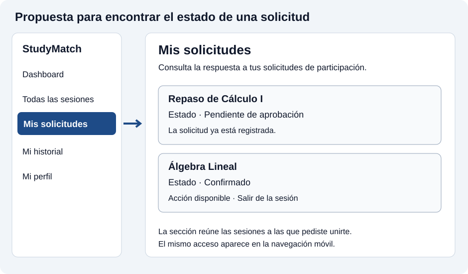
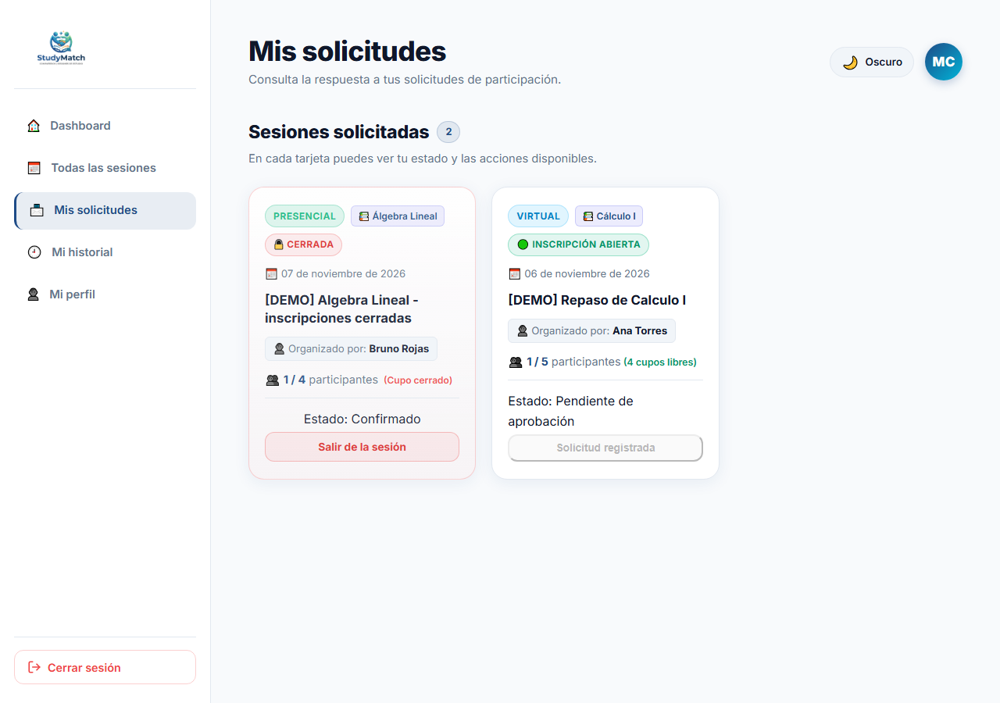
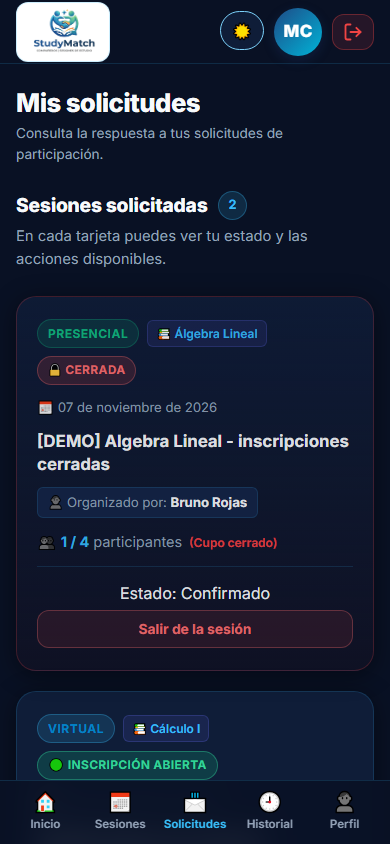

# Clase 20 — Arquitectura de información

Integrante Jose Brayan Gonzales Alba.

Proyecto StudyMatch. Clase virtual del 5 de noviembre de 2026.

## Problema elegido

La tarea consiste en consultar si el organizador aceptó una solicitud para estudiar Cálculo I.

El Dashboard reúne sesiones disponibles, sesiones propias, sesiones llenas y sesiones para las que el estudiante envió solicitudes. El estado de una solicitud aparece dentro de la tarjeta correspondiente. Para encontrarlo, el estudiante debe localizar esa sesión entre las demás. El menú ofrece Todas las sesiones y Mi historial, pero falta un acceso que anticipe dónde consultar las solicitudes enviadas.

La captura anterior al cambio corresponde a Carla, una cuenta de demostración. El listado tenía 64 sesiones, incluidas las creadas por las pruebas automáticas. Se guardó la página completa, por lo que la imagen es larga y permite observar las solicitudes entre las demás tarjetas.

[Ver captura completa del antes](clase-20/antes.png).

## Propuesta y motivo

Agregar Mis solicitudes al menú principal y a la navegación móvil. La sección reúne las sesiones para las que la cuenta autenticada tiene una solicitud y muestra el estado y las acciones correspondientes en cada tarjeta.



| Pregunta de la clase | Decisión |
| --- | --- |
| ¿Qué busca? | Consultar la respuesta a una solicitud de participación. |
| ¿Cómo lo llama? | Mis solicitudes, para anticipar que allí están las solicitudes que envió la persona. |
| ¿Dónde lo espera? | En el menú principal, junto a Todas las sesiones y Mi historial. En móvil, en la barra inferior como Solicitudes. |

Se eligió una sección con acceso propio y una dirección que permite volver directamente a ella. El título, el contador y las tarjetas presentan las sesiones solicitadas. Los estados mantienen el vocabulario del sistema, como Pendiente de aprobación, Confirmado y En espera con su posición.

## Implementación

La ruta privada `/mis-solicitudes` utiliza el componente Dashboard con la propiedad `onlyMyRequests`. Para obtener los datos, se reutilizan las consultas de sesiones y de solicitudes de la cuenta autenticada.

Se construye un conjunto con los identificadores de las sesiones solicitadas y se muestran las sesiones que pertenecen a ese conjunto. Las tarjetas ofrecen las acciones existentes, incluida la retirada de una sesión confirmada y la reconfirmación cuando corresponde.

Cada ruta utiliza una clave distinta de React para reiniciar el estado de la vista al cambiar de sección. Así, una búsqueda anterior o el filtro de cupos disponibles del listado general permiten entrar a Mis solicitudes y consultar también una sesión llena.

Cuando la cuenta aún no tiene solicitudes, se muestra Aún no has enviado solicitudes y un acceso Buscar sesiones. Si falla la carga de datos, aparece un mensaje con la opción Reintentar.

| Archivo | Cambio |
| --- | --- |
| `frontend/src/App.jsx` | Ruta privada y claves de las dos vistas. |
| `frontend/src/pages/Dashboard.jsx` | Selección de sesiones solicitadas, título, estado vacío y accesos de navegación. |
| `frontend/src/pages/History.jsx` | Acceso desde el historial, en escritorio y móvil. |
| `frontend/src/pages/Profile.jsx` | Acceso desde el perfil, en escritorio y móvil. |
| `frontend/src/styles/Dashboard.css` | Espaciado de los cinco accesos de la barra móvil. |
| `tests/mis-solicitudes.spec.js` | Verificación de estados, cuenta actual, filtros anteriores, retirada, recarga, móvil y acceso privado. |

## Después

Se utilizó la misma cuenta de Carla. Mis solicitudes muestra dos sesiones, una confirmada y otra pendiente de aprobación.



Se revisó también la presentación en un viewport móvil de 390 × 844 y modo oscuro. La captura muestra el área visible al abrir la sección.



## Comprobación

La tarea de consulta elegida es encontrar el estado de la solicitud para Repaso de Calculo I. Con Carla se accede desde Mis solicitudes y se encuentra Pendiente de aprobación en su tarjeta.

El estudiante comunicó que el docente dispensó la búsqueda de otra persona para esta actividad porque la clase fue virtual. La comprobación registrada aquí corresponde a la revisión del recorrido y a las pruebas automatizadas.

Las dos pruebas nuevas pasaron en Chromium en 24,5 segundos.

| Caso comprobado | Resultado |
| --- | --- |
| Una cuenta ve la sesión que solicitó y su estado pendiente | Aprobado. |
| La sección excluye otra sesión para la que esa cuenta carece de solicitud | Aprobado. |
| Tras la aceptación, aparece Confirmado con el cupo completo | Aprobado. |
| Entrar después de utilizar búsqueda y cupos disponibles muestra la solicitud de la sesión llena | Aprobado. |
| Recargar conserva la sección y el estado confirmado | Aprobado. |
| Salir de la sesión desde Mis solicitudes actualiza el estado a Saliste de la sesión | Aprobado. |
| En móvil se puede volver desde el historial a Mis solicitudes | Aprobado. |
| Una visita sin autenticación conduce al inicio de sesión | Aprobado. |
| Una cuenta sin solicitudes encuentra el mensaje y puede ir a Buscar sesiones | Aprobado. |

Para repetir los casos nuevos desde la raíz, con frontend y backend ejecutándose

```powershell
pnpm exec playwright test tests/mis-solicitudes.spec.js --project=chromium --workers=1 --reporter=line --trace=off
```

La suite completa pasó con **33 de 33 pruebas en Chromium en 4,6 minutos**. Incluye los flujos anteriores de sesiones, lista de espera y reprogramación. La compilación del frontend con `npm run build` terminó correctamente. Se comprobó además que los cinco accesos de navegación caben dentro de un ancho móvil de 320 píxeles.

```powershell
pnpm exec playwright test --project=chromium --workers=1 --reporter=line --trace=off
```

Las pruebas nuevas crean cuentas y sesiones ficticias propias en la base local. Las capturas de esta entrega utilizan la cuenta de demostración de Carla.

## Commit

Pendiente de crear y enlazar. Mensaje propuesto `feat: agregar Mis solicitudes a la navegación de StudyMatch`.
