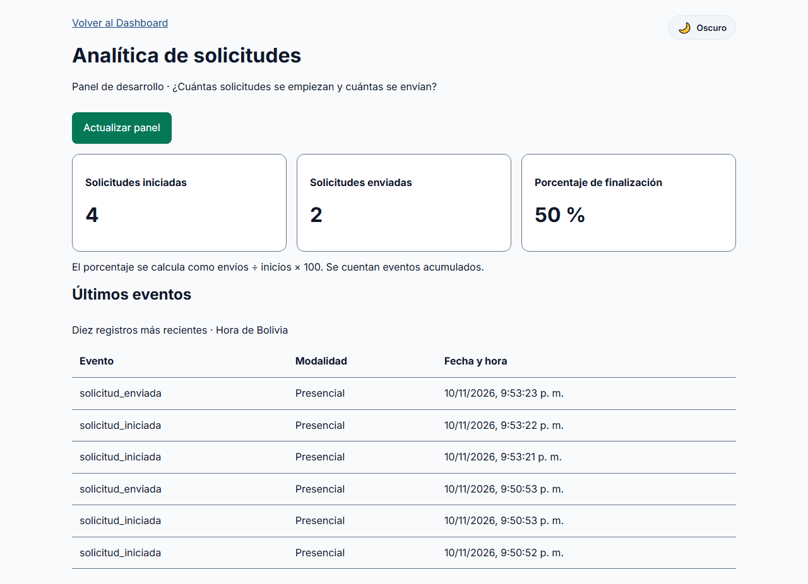
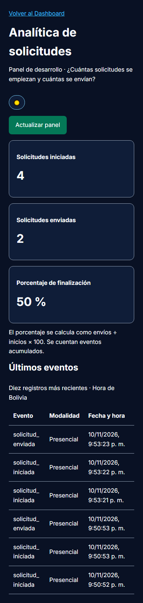

# Clase 21 — Dos eventos, un panel y una decisión

Integrante Jose Brayan Gonzales Alba.

Proyecto StudyMatch. Trabajo de clase del 10 de noviembre de 2026.

## Pregunta elegida

¿Cuántas veces se empieza una solicitud para unirse a una sesión y cuántas veces se envía correctamente?

Se eligió medir el recorrido de solicitar participación mediante el diálogo existente. Se cuentan aperturas y envíos acumulados. Una misma persona puede abrir el diálogo varias veces.

## Definición de los eventos

| Evento | Momento | Propiedad guardada | Pregunta |
| --- | --- | --- | --- |
| `solicitud_iniciada` | Al abrir el diálogo para solicitar participación. | Modalidad de la sesión, con los valores Presencial, Virtual u Otra. | ¿Cuántas veces se empezó el recorrido? |
| `solicitud_enviada` | Al guardar una solicitud nueva en la base de datos. | La misma modalidad controlada. | ¿Cuántas solicitudes se enviaron correctamente? |

Cada registro también tiene un identificador y una fecha con zona horaria. El panel presenta la fecha en `America/La_Paz`, hora de Bolivia.

## Implementación y ubicación

| Archivo y línea | Responsabilidad |
| --- | --- |
| [models.py, línea 299](../backend/app/models.py#L299) | Tabla `analytics_events` y restricciones de valores. |
| [schemas.py, línea 364](../backend/app/schemas.py#L364) | Datos de entrada y salida. La petición de inicio acepta únicamente el identificador de sesión. |
| [analytics.py, línea 14](../backend/app/routers/analytics.py#L14) | Registro de un inicio y consulta de los conteos. |
| [sessions.py, línea 399](../backend/app/routers/sessions.py#L399) | Registro del evento de envío en la transacción que guarda la solicitud. |
| [main.py](../backend/app/main.py) | Registro del router de analítica. |
| [Dashboard.jsx, línea 345](../frontend/src/pages/Dashboard.jsx#L345) | Apertura del diálogo y llamada para registrar el inicio. |
| [Analytics.jsx](../frontend/src/pages/Analytics.jsx) | Panel de conteos, porcentaje y últimos eventos. |
| [Analytics.css](../frontend/src/styles/Analytics.css) | Presentación en escritorio, móvil y ambos temas. |
| [App.jsx, línea 62](../frontend/src/App.jsx#L62) | Ruta privada `/analitica`. |

El backend agrega el evento de envío a la misma transacción de la solicitud. Ambos registros se confirman con `db.commit()`. Si la transacción falla, se revierten juntos. Las solicitudes rechazadas por las validaciones o por duplicación conservan el contador de envíos.

El inicio se registra desde el controlador de apertura del diálogo. Se conserva la promesa de esa petición para esperar su finalización antes de enviar la solicitud. Tiene un límite de tres segundos. Si falla la medición del inicio, la solicitud puede continuar y se registra el error en consola. En ese caso, los conteos pueden quedar incompletos. El porcentaje representa el cociente de eventos disponibles.

## Panel propio

Con la aplicación en ejecución y una sesión de usuario iniciada, se abre `http://localhost:5173/analitica`.

El panel muestra las cantidades acumuladas de inicios y envíos, el porcentaje calculado como `envíos / inicios × 100` y los diez eventos más recientes. Cuando hay cero inicios, el porcentaje es cero. El botón Actualizar panel vuelve a consultar los datos. También se ofrece reintentar después de un error de carga.

Las rutas del backend son `POST /analytics/start` y `GET /analytics/summary`. Ambas requieren autenticación. Los conteos del panel corresponden al conjunto de eventos de la aplicación local.





## Datos y privacidad

Se guarda la modalidad para permitir una comparación entre encuentros presenciales y virtuales. Los valores que salen de esa lista se clasifican como Otra.

Se decidió excluir de la analítica el nombre, correo, identificador de cuenta, texto de la solicitud y nombre de la sesión. La materia admite entradas personalizadas en StudyMatch, por lo que se eligió la modalidad controlada como propiedad mínima.

El identificador de sesión recibido al registrar el inicio se utiliza para consultar su modalidad. La tabla de eventos guarda exclusivamente `id`, `event`, `modality` y `created_at`. La autenticación permite utilizar el endpoint y su identidad pertenece al funcionamiento normal de la aplicación.

## Pruebas y resultado

Se prepararon cuentas ficticias y una sesión de estudio mediante los formularios reales. El recorrido automatizado abre el diálogo dos veces, cancela la primera apertura y envía la segunda. Comprueba un incremento de dos inicios y un envío, revisa el porcentaje y recarga el panel para comprobar persistencia.

Las capturas provienen de ese escenario controlado. En el ejemplo se observa una finalización del 50 %. Las cantidades globales pueden aumentar con las siguientes pruebas y usos de la aplicación.

| Comprobación | Resultado |
| --- | --- |
| Un inicio crea un registro con las propiedades previstas | Aprobado. |
| Una solicitud nueva crea un evento de envío | Aprobado. |
| Repetir una solicitud o intentar una operación inválida conserva el contador de envíos | Aprobado. |
| Una transacción fallida revierte la solicitud y su evento | Aprobado. |
| Peticiones con campos adicionales son rechazadas | Aprobado. |
| Conteos, porcentaje y caso de cero eventos | Aprobado. |
| Apertura cancelada, envío, consulta y recarga en el navegador | Aprobado. |
| Acceso privado y recuperación de un error del panel | Aprobado. |

Las 65 pruebas del backend pasaron. Después se amplió la prueba de transacción para simular un error tras ejecutar los INSERT y los cuatro casos de analítica volvieron a pasar. La compilación del frontend pasó. La comprobación final de navegador terminó con **14 pruebas aprobadas en Chromium en 4,8 minutos**, incluidos los dos casos nuevos, la confirmación en ambos temas, las sesiones y la lista de espera.

Las pruebas del backend están en [test_analytics.py](../backend/tests/test_analytics.py). Utilizan una base SQLite aislada. Las pruebas del navegador están en [analitica.spec.js](../tests/analitica.spec.js) y utilizan PostgreSQL local. Crean datos ficticios que permanecen en esa base después de terminar.

Desde la carpeta `backend`

```powershell
.\venv\Scripts\python.exe -m pytest -q
```

Desde la raíz, con backend y frontend ejecutándose

```powershell
pnpm exec playwright test tests/analitica.spec.js --project=chromium --workers=1 --reporter=line --trace=off
```

Comprobación de los recorridos relacionados

```powershell
pnpm exec playwright test tests/analitica.spec.js tests/confirmacion.spec.js tests/sesiones.spec.js tests/lista-espera.spec.js --project=chromium --workers=1 --reporter=line --trace=off
```

## Decisión a partir del resultado

La caída del escenario preparado está entre abrir el diálogo y enviar la solicitud. El abandono fue provocado por la propia prueba, así que sirve para comprobar la medición.

Si se observara esa caída con uso real, revisaría el contenido del diálogo y si explica con claridad qué ocurre después de enviar la solicitud. Propondría comprobar con personas si una explicación más breve y visible ayuda a completar el recorrido. Se contrastaría la proporción de envíos antes y después del cambio.

## Commit

[Ver commit de la mejora 5d4741f](https://github.com/BrayanG123/2do_Proyeccto_IHC/commit/5d4741ff52cc79701984012bca5efd1598773f68), con el mensaje `medir solicitudes y mostrar el panel de analitica`.
