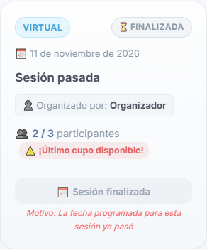
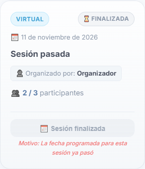

# Clase 22 — Patrones oscuros

Integrante Jose Brayan Gonzales Alba. Modalidad con IA.

## Patrón encontrado

- **Tipo:** urgencia o escasez engañosa.
- **Ubicación:** tarjeta de sesión en [Dashboard.jsx](../frontend/src/pages/Dashboard.jsx).
- **Problema:** una sesión pasada que conservaba un cupo libre mostraba «¡Último cupo disponible!». La misma tarjeta indicaba que la fecha había pasado y no permitía solicitar participación. El aviso sugería una disponibilidad que la persona no podía aprovechar.
- **Beneficio y efecto:** el aviso de escasez empuja a solicitar una plaza. En una sesión pasada da una señal contradictoria que puede inducir a error.

## Antes

El aviso dependía del estado de inscripción y del número de plazas, sin comprobar la fecha ni la finalización.

```jsx
!isClosed && !isFull && ((session.spots || 0) - (session.participants_count || 0) === 1)
```



## Después

Los avisos de último cupo y de cupos libres también comprueban que la fecha no haya pasado y que la sesión no se haya finalizado. La captura muestra la misma sesión de prueba.

```jsx
!isClosed && !isPastDate && !session.finished_at && !isFull
```



## Principio aplicado

**Honestidad de la interfaz y prevención de errores, heurística H5 de Nielsen.** La tarjeta presenta la disponibilidad cuando el estado y la fecha permiten solicitar participación. El contador de participantes sigue visible para informar sobre la sesión.

## Prueba

[clase-22.spec.js](../tests/clase-22.spec.js) comprueba una sesión futura con un cupo, una pasada con uno, una finalizada, una pasada con dos, una cerrada y una llena. La prueba utiliza respuestas controladas de la API y el navegador real.

Antes de la corrección, la prueba **falló** porque la sesión pasada mostraba el aviso. Después, **pasó** en Chromium. Las capturas se generaron con los mismos datos controlados.

La compilación del frontend pasó. La suite completa terminó con **39 pruebas de Chromium y 80 pruebas del backend aprobadas**.
