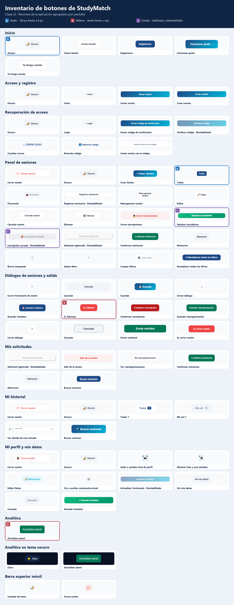

# Clase 23 · Inventario y tokens

**Proyecto:** StudyMatch  
**Integrante:** Jose Brayan Gonzales Alba  
**Modalidad:** con IA

## 1. Inventario de botones

Revisé Inicio, Iniciar sesión, Registro, Recuperación de acceso, el Panel de sesiones y sus diálogos, Mis solicitudes, Mi historial, Mi perfil y Analítica. La imagen reúne 75 recortes de StudyMatch en Chromium con datos de demostración. Incluye botones, enlaces con apariencia de botón y controles de la barra móvil. Cuando una variante se repite en una misma pantalla, se muestra una instancia representativa.

| Marca | Diferencia observada |
| --- | --- |
| A · Radio | «Oscuro» tiene un radio de **100 px**, mientras que el filtro «Todas» tiene **6 px**. |
| B · Relleno | «Actualizar panel» usa verde sólido (`#047857`) y «Sí, Eliminar» usa rojo sólido (`#ef4444`) en tema claro. |
| C · Estado | «Solicitar Inscribirme» está habilitado en una sesión abierta. «Inscripción cerrada» aparece atenuado y deshabilitado cuando ya no se reciben solicitudes. |

## 2. Cinco tokens de diseño

Los cinco tokens están definidos para ambos temas en [index.css](../frontend/src/index.css#L7). El nombre del inventario describe su función y la columna «Variable CSS» conserva el nombre que ya usa la app.

| Token | Variable CSS | Claro | Oscuro | Dónde se usa |
| --- | --- | --- | --- | --- |
| `color-accion` | `--primary` | `#1e4b87` | `#38bdf8` | Enlace al Dashboard y barras de los embudos en Analítica. |
| `color-fondo-pagina` | `--bg` | `#f8fafc` | `#091124` | Fondo general de la app y pantallas de acceso. |
| `color-fondo-tarjeta` | `--surface` | `#ffffff` | `#0f1d38` | Tarjetas de embudos y panel de mayor caída en Analítica. |
| `color-texto-principal` | `--text` | `#0f172a` | `#f8fafc` | Texto principal de la página de Analítica y de los campos del formulario de acceso. |
| `color-texto-secundario` | `--text-muted` | `#64748b` | `#94a3b8` | Notas de Analítica y subtítulos de los formularios de acceso. |

## 3. Conteo de colores fijos

**Pantalla revisada:** Analítica de StudyMatch (`/analitica`). Busqué colores hexadecimales y funciones de color como `rgb()`, `rgba()` y `hsl()` en el [componente de la pantalla](../frontend/src/pages/Analytics.jsx) y su [hoja de estilos](../frontend/src/styles/Analytics.css). El conteo toma cada valor literal como una ocurrencia y excluye las referencias `var(...)` y las definiciones globales del tema.

**Resultado: 2 ocurrencias**, ambas en `.analytics-refresh`.

| Color fijo | Uso | Ubicación |
| --- | --- | --- |
| `#047857` | Fondo de «Actualizar panel». | [Analytics.css, línea 28](../frontend/src/styles/Analytics.css#L28) |
| `#fff` | Texto de «Actualizar panel». | [Analytics.css, línea 29](../frontend/src/styles/Analytics.css#L29) |
