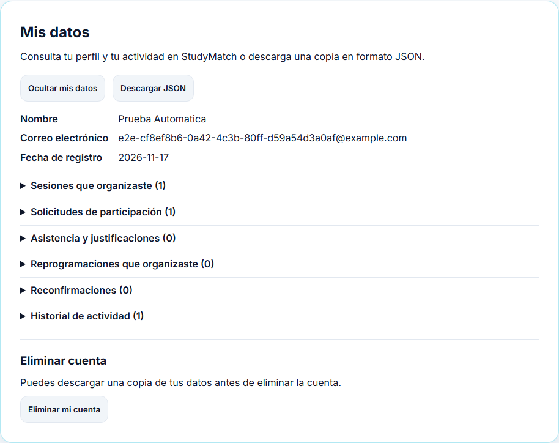
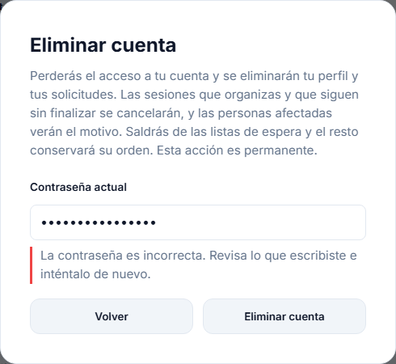
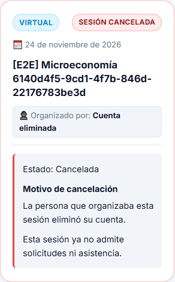

# Tarea 10 — Mis datos y salida honesta

Proyecto StudyMatch. Integrante Jose Brayan Gonzales Alba.

## Mis datos y eliminación de cuenta

Desde **Mi Perfil → Mis datos**, la persona puede consultar su perfil y su actividad o descargar `mis-datos-studymatch.json`. El archivo reúne sus sesiones organizadas, solicitudes, asistencia y justificaciones, reprogramaciones, reconfirmaciones e historial. Las credenciales, los códigos de recuperación y las listas de correos de otras personas quedan fuera de la descarga. [Pantalla de Mis datos](../frontend/src/components/AccountData.jsx) · [Selección de datos](../backend/app/account_data.py)

El diálogo de eliminación explica las consecuencias antes de actuar y presenta dos botones del mismo tamaño, **Volver** y **Eliminar cuenta**. La persona confirma su identidad con la contraseña actual en ese mismo diálogo. Una contraseña incorrecta bloquea la operación y el mensaje explica cómo reintentarla.

La eliminación y sus efectos se guardan en una transacción. Se cancelan las sesiones que la persona organizaba y que aún no se habían finalizado. Las personas confirmadas, pendientes o en espera ven el motivo en **Mis solicitudes**. Las sesiones finalizadas conservan el historial de las demás personas bajo el nombre «Cuenta eliminada». La cuenta sale de las listas de espera sin cambiar el orden relativo de quienes permanecen. Si libera una plaza en una sesión abierta y vigente de otra persona, se aplica la promoción habitual por orden de llegada.

## Revisión de los seis patrones

| Patrón | Qué encontramos | Qué corregimos | Qué queda pendiente |
| --- | --- | --- | --- |
| Opciones preseleccionadas | En el registro y la confirmación de cuenta no hay opciones de consentimiento preactivadas. El selector de modalidad de sesiones tiene un valor inicial visible y editable. | No se necesitó una corrección en los flujos revisados. | Sin hallazgos pendientes. |
| Confirmaciones engañosas | En recuperación de contraseña, «Omitir y volver al login» abría directamente el Dashboard con una sesión iniciada. | Se renombró a **Iniciar sesión con el código**. El diálogo de eliminación de cuenta identifica cada acción y explica el resultado. | Sin hallazgos pendientes en estos flujos. |
| Urgencia, culpa o escasez falsas | En Clase 22 se reprodujo que una sesión pasada anunciaba un último cupo disponible. | La corrección de Clase 22 limita los avisos a sesiones abiertas y vigentes. El diálogo nuevo explica las consecuencias con lenguaje neutral. | Sin hallazgos pendientes. |
| Datos expuestos sin necesidad | La API de sesiones devolvía los correos del organizador y de los participantes, incluso en el listado general. | Se retiraron esos campos de las respuestas de sesión. El listado indica únicamente si la persona que consulta organiza la sesión o participa en ella. | Revisar si el organizador necesita el correo completo en las vistas autenticadas de solicitudes y asistencia. |
| Salir es más difícil que entrar | El perfil carecía de una opción para eliminar la cuenta. La participación confirmada tiene una acción para salir. | Se añadió **Eliminar mi cuenta** en el perfil con un solo diálogo y la verificación de identidad en el mismo paso. | En **Mis solicitudes** sigue pendiente una acción para retirar voluntariamente una solicitud en espera o pendiente manteniendo la cuenta. |
| Permisos sin explicar | Los flujos revisados de acceso, búsqueda, sesiones y perfil no piden permisos del dispositivo al abrirse. Cambiar foto abre el selector cuando la persona lo solicita. | El flujo nuevo no pide permisos adicionales. | Sin hallazgos pendientes. |

## Analítica

| Recorrido | Inicio | Éxito | Bloqueo |
| --- | --- | --- | --- |
| Descargar datos | `descarga_datos_iniciada` al pulsar **Descargar JSON** | `datos_descargados` cuando la API entrega el archivo | `descargar_datos_bloqueo` si la API rechaza la solicitud |
| Eliminar cuenta | `eliminacion_cuenta_iniciada` al abrir la confirmación | `cuenta_eliminada` después de guardar la operación | `eliminar_cuenta_bloqueo` si falla una validación o se rechaza la identidad |

Los eventos usan un identificador aleatorio de intento, una fecha y, para los bloqueos, un código fijo. No reciben el correo, la contraseña ni el contenido descargado. [Catálogo de eventos](../backend/app/analytics_events.py)

## Demostración

La prueba de Playwright utiliza cinco cuentas ficticias. Comprueba la descarga y su contenido, el bloqueo con una clave incorrecta, la eliminación aceptada, la pérdida de acceso, el aviso de cancelación a los tres estados de participación y la conservación del orden de otra cola. También comprueba los eventos de inicio, éxito y bloqueo. [tarea-10.spec.js](../tests/tarea-10.spec.js)

Para repetir el recorrido, ejecuta este comando desde la raíz con el frontend y el backend activos.

```powershell
pnpm exec playwright test tests/tarea-10.spec.js --project=chromium --workers=1
```







Pasaron **83 pruebas del backend y 40 en Chromium**. También pasó la compilación del frontend.

La funcionalidad está en el commit `b4c084e`. La revisión de patrones y sus correcciones se guardan en otro commit.
