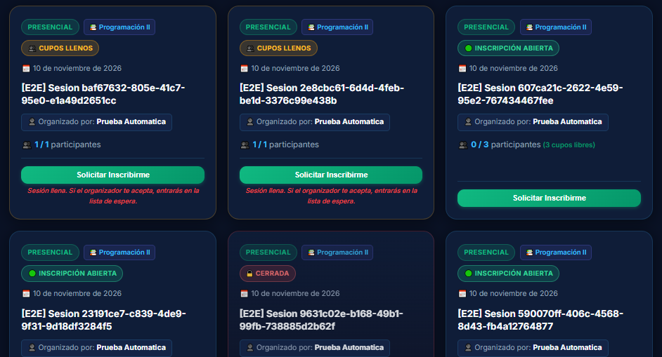
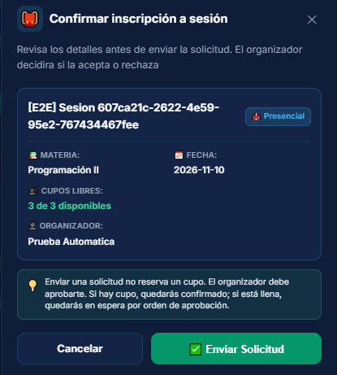
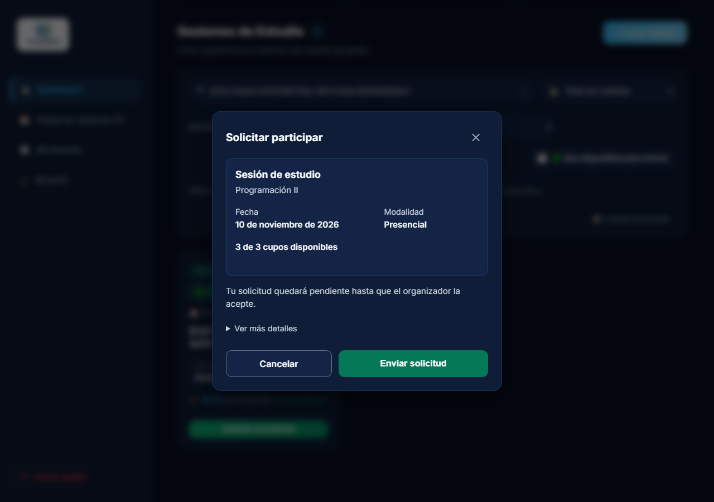
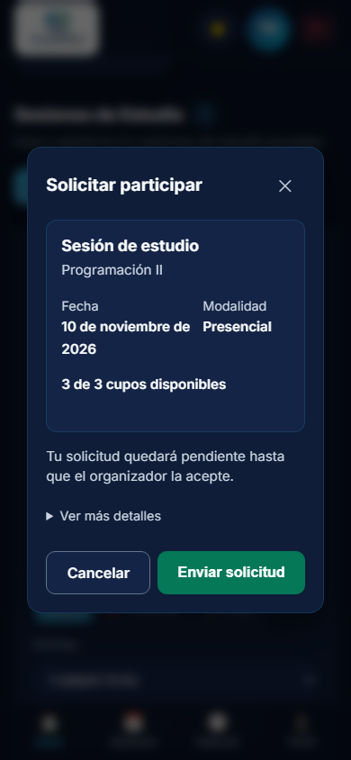
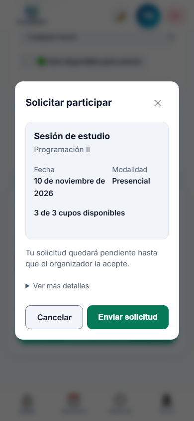
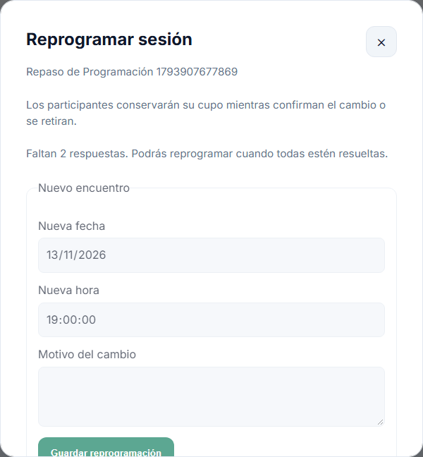
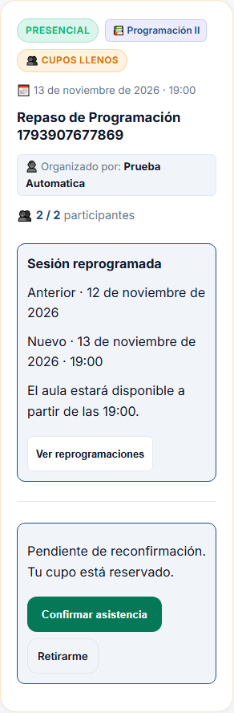
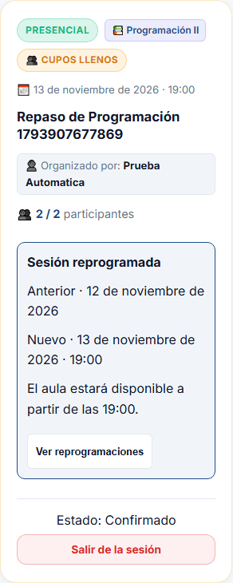
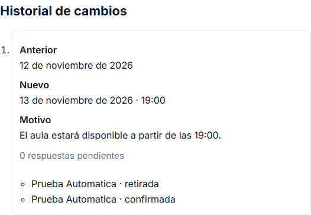
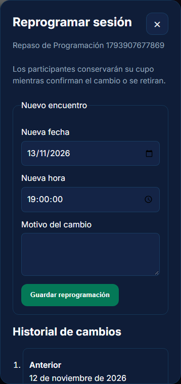

# Tarea 7 — Mejora por feedback y reprogramación con reconfirmación

Proyecto StudyMatch. Documento preparado el 5 de noviembre de 2026.

La entrega requiere dos cambios y dos commits separados. El primero corresponde a una mejora basada en el feedback recibido. El segundo corresponde a reprogramar una sesión con reconfirmación de sus participantes.

| Entregable | Estado | Commit |
| --- | --- | --- |
| Mejora por feedback | Diálogo simplificado y contraste comprobado. Evidencias antes y después incluidas. | `dbdd928` |
| Reprogramación con reconfirmación | Implementada. Pruebas y evidencias descritas en la sección 2. | Pendiente de crear |

## 1. Mejora basada en el feedback

### Feedback recibido

| Dato | Información proporcionada por el evaluador |
| --- | --- |
| Evaluador | Daniel Joaquin Mamani Pena |
| Proyecto del evaluador | Súmate, caso Voluntariado Cerca |
| Proyecto evaluado | StudyMatch |
| Integrante evaluado | Brayan Gonzales |
| Fecha de evaluación | 03/11/2026 |
| Versión indicada | Rama `main`, commit `74331cc` |
| Aplicación evaluada | Ejecutada en local |
| Repositorio evaluado | https://github.com/BrayanG123/2do_Proyeccto_IHC |

El feedback original está publicado en el repositorio del evaluador. [Feedback de Daniel](https://github.com/Joabits/sumate-app/blob/main/clase-19-feedback-a-otro-proyecto/mamani-pena/feedback.md).

Daniel completó sin ayuda los dos recorridos que probó.

- Buscó una sesión por materia, solicitó participar y vio el estado de su solicitud.
- Creó una sesión y comprobó que apareciera con la materia, fecha y cupos ingresados.

Su dificultad estuvo en la lectura del modo oscuro. Indicó que algunos textos y botones se confundían con el fondo y propuso mejorar el contraste, con una referencia de al menos 4,5 a 1 para el texto. También señaló que la organización de la experiencia podía mejorar. Consideró necesarias las funciones existentes.

El estudiante aclaró posteriormente que la observación sobre la organización se refería al diálogo **Confirmar inscripción a sesión**. Según esa aclaración, al evaluador le resultó confuso el nombre largo de una sesión de prueba y encontró demasiada información para leer antes de enviar la solicitud.

### Problema elegido

El diálogo de confirmación requiere leer varios bloques antes de solicitar participar. En las capturas aparece además una sesión con un nombre generado por las pruebas automáticas, como `[E2E] Sesion 607ca21c-2622-4e59-95e2-767434467fee`, que dificulta reconocer el tema de estudio.

El origen de ese nombre está en los datos creados para las pruebas E2E. La mejora del diálogo reconoce ese formato generado y muestra un título legible junto con la materia. Los nombres personalizados se presentan completos.

### Antes del cambio

Las dos capturas siguientes fueron proporcionadas por el estudiante el 5 de noviembre. Documentan el estado anterior que observó en pantalla. El evaluador indicó haber probado el commit `74331cc` el 3 de noviembre. No se ha verificado que las capturas correspondan exactamente a ese commit.

En el listado aparecen sesiones con nombres de prueba largos y avisos de cupos y estado. La tercera tarjeta de la primera fila corresponde a la sesión que se muestra después en el diálogo.



Al solicitar participar se muestra un diálogo con título, explicación inicial, nombre de la sesión, modalidad, materia, fecha, cupos, organizador, explicación de aprobación y espera y botones de acción. Algunas etiquetas se ven tenues en modo oscuro. Al reproducir la ventana se midió un contraste de 3,77 a 1 para el texto blanco sobre el verde del botón principal.



### Pasos para reproducir y comparar

1. Iniciar sesión con una cuenta de prueba y activar el modo oscuro.
2. Buscar una sesión abierta de otro organizador.
3. Pulsar **Solicitar Inscribirme**.
4. Observar el diálogo **Confirmar inscripción a sesión** y la cantidad de información que requiere leer.
5. Comparar con la captura anterior, prestando atención al nombre de prueba largo y a la legibilidad de las etiquetas.

Se reprodujo el problema el 5 de noviembre con Ana y una sesión existente de Programación II. Se guardaron nuevas capturas del mismo escenario, antes de editar el código, a 1280 × 900 y 390 × 844 píxeles. Se utilizó esa misma sesión y esos tamaños al capturar el resultado.

[Antes reproducido en escritorio](tarea-7/antes/03-dialogo-escritorio-oscuro.png) · [Antes reproducido en móvil](tarea-7/antes/04-dialogo-movil-oscuro.png).

### Mejora propuesta

Simplificar la organización del diálogo para que la sesión y la acción de enviar la solicitud se entiendan con facilidad. Utilizar nombres comprensibles en los datos de demostración y revisar la legibilidad de los textos en modo oscuro.

Se eligió una distribución con información principal visible y datos secundarios desplegables, descrita en el cambio realizado.

| Archivo modificado | Responsabilidad relacionada |
| --- | --- |
| `frontend/src/pages/Dashboard.jsx` | Contenido del diálogo y acciones de la solicitud. |
| `frontend/src/styles/Dashboard.css` | Distribución y colores del diálogo en ambos temas. |
| `tests/confirmacion.spec.js` | Contraste y comportamiento del diálogo en ambos temas, con nombres personalizados y generados. |
| `tests/sesiones.spec.js` y `tests/lista-espera.spec.js` | Selectores actualizados a los nuevos textos de la interfaz. |

### Cambio realizado

- El título del diálogo pasa a **Solicitar participar**, coherente con el envío de una solicitud pendiente.
- La información inicial se concentra en nombre, materia, fecha legible, modalidad y cupos disponibles.
- El organizador y la ubicación, cuando existen, están en **Ver más detalles**.
- La explicación de aprobación se resume en una frase. Una sesión llena informa que aceptar la solicitud llevará a la lista de espera.
- Las sesiones cuyo nombre coincide exactamente con el formato automatizado `[E2E] … UUID` se presentan en este diálogo como **Sesión de estudio**, con su materia debajo. Esta decisión afecta a la presentación del diálogo. Los nombres personalizados se muestran completos.
- Se aumenta el contraste del botón principal y de los textos secundarios, se mantienen controles de al menos 44 píxeles y se permite cerrar con Escape.
- Los datos usados en las capturas pertenecen a la misma sesión de prueba antes y después. La mejora visible procede del cambio de presentación.

### Después del cambio

Se capturó el mismo diálogo después del cambio en escritorio y móvil. Se desactivaron las animaciones durante la captura para mostrar el estado final de la ventana.







### Comprobación

| Comprobación prevista | Resultado |
| --- | --- |
| Revisar la jerarquía de la información en el diálogo | Revisada en escritorio y móvil. Se accede al organizador desplegando el detalle. |
| Medir el contraste de los textos que se modifiquen | El botón pasa de 3,77 a 5,48 a 1. Mínimo de textos medidos en el diálogo actualizado, 4,76 a 1 en claro y 5,48 a 1 en oscuro. |
| Comprobar la legibilidad en modo claro y oscuro | Capturas revisadas en ambos temas y medición automatizada de colores CSS. |
| Enviar una solicitud y comprobar su confirmación y estado | Aprobado en las pruebas nuevas de ambos temas. |
| Recargar y comprobar que el estado se conserva | Aprobado en las pruebas nuevas de ambos temas. |
| Ejecutar la prueba E2E relacionada | 12 pruebas relacionadas aprobadas en Chromium, en 2,7 minutos. Incluyen los dos temas, sesiones y lista de espera. |

El contraste se calculó con los colores CSS del texto y su fondo, componiendo transparencias. Esta medición corresponde a los elementos comprobados del diálogo. La revisión visual y las pruebas funcionales verifican su presentación y funcionamiento. La facilidad de comprensión después del cambio requiere una nueva evaluación con una persona.

Para repetir los casos relacionados desde la raíz, con la aplicación en ejecución

```powershell
pnpm exec playwright test tests/confirmacion.spec.js tests/sesiones.spec.js tests/lista-espera.spec.js --project=chromium --workers=1 --reporter=line --trace=off
```

La compilación del frontend con `npm run build` terminó correctamente.

Commit de la mejora `dbdd928`, con el mensaje `fix: simplificacion el dialogo de solicitud y mejorar su contraste`.

## 2. Reprogramación de una sesión con reconfirmación

La funcionalidad asignada en la diapositiva 13 amplía el recorrido existente.

- El organizador cambia la fecha u horario e indica el motivo.
- Los participantes confirmados pasan a pendientes de reconfirmación y conservan temporalmente su cupo.
- Cada participante acepta el cambio o se retira.
- Una retirada libera el cupo y promueve al primero de la lista de espera.
- Mientras existan reconfirmaciones pendientes, se bloquea otra reprogramación.

### Punto de partida

En el commit anterior, `dbdd928`, las sesiones tenían fecha y podían editarse desde el formulario general. La lista de espera ya permitía aprobar solicitudes, ocupar cupos y promover al primero cuando un participante salía.

La tarea agrega el motivo del cambio, la hora de encuentro, el historial de reprogramaciones y una respuesta individual de los participantes confirmados.

### Datos y reglas implementadas

| Dato | Dónde se guarda | Para qué sirve |
| --- | --- | --- |
| Hora de encuentro | `sessions.time` | Permite cambiar el horario. Es opcional para poder utilizar las sesiones antiguas que solo tenían fecha. |
| Reprogramación | `session_reschedules` | Guarda la fecha y hora anteriores, las nuevas, el motivo, el organizador y el momento del cambio. |
| Respuesta de cada participante | `session_reconfirmations` | Guarda una respuesta por participante y reprogramación, con su estado y el momento de respuesta. |

Las respuestas tienen tres estados.

| Acción | Estado de reconfirmación | Efecto sobre el cupo |
| --- | --- | --- |
| El organizador reprograma | `pendiente` | El participante conserva su cupo. |
| El participante pulsa Confirmar asistencia | `confirmada` | Conserva su cupo y acepta el nuevo encuentro. |
| El participante pulsa Retirarme o Salir de la sesión | `retirada` | Libera su cupo. La primera solicitud aprobada en espera pasa a confirmada si la sesión está abierta y vigente. |

Mientras una respuesta está pendiente, la solicitud de ingreso sigue aceptada y el participante continúa en el contador de ocupación. Al retirarse, también se actualiza la solicitud de ingreso a `retirada`.

El organizador debe indicar un motivo de entre 3 y 1000 caracteres y cambiar efectivamente la fecha o la hora. La fecha nueva debe ser hoy o posterior. Se eligió permitir la reprogramación con las inscripciones abiertas, en coherencia con la regla de promoción de la lista de espera. Para una sesión cerrada, el organizador puede abrir las inscripciones desde la edición.

Otra reprogramación queda bloqueada mientras exista alguna respuesta pendiente. La validación se aplica también al intentar cambiar fecha u hora desde la edición general. Cuando hay participantes, esos campos se cambian mediante **Reprogramar sesión**, donde se registra el motivo.

La reprogramación, la confirmación y la retirada bloquean la fila de la sesión durante su transacción. Cada respuesta corresponde a un participante y a un cambio concreto. Repetir una confirmación o una retirada devuelve un conflicto HTTP 409. Esto evita descontar dos veces el cupo o repetir una promoción.

Al iniciar el backend se crean las dos tablas y se añade la columna de hora a la base existente. Los participantes de sesiones antiguas se reconocen por sus correos guardados. Para las solicitudes aceptadas también se utiliza el correo registrado al confirmar, lo que permite reconocer a quien después cambió el correo de su perfil.

### Recorrido comprobado

Se utilizaron cuatro cuentas ficticias y cuatro contextos de navegador independientes, con una sesión futura de dos cupos.

1. El organizador aceptó a dos estudiantes y aprobó una tercera solicitud, que quedó primera en espera.
2. Reprogramó la fecha y fijó las 19:00, indicando el motivo.
3. El contador siguió en **2 / 2** y aparecieron **2 respuestas pendientes**. El formulario de otra reprogramación quedó bloqueado.
4. Ambos estudiantes vieron la fecha anterior, la nueva, el motivo y el aviso de cupo reservado después de recargar.
5. El primer estudiante confirmó su asistencia. El contador siguió en **2 / 2** y quedó una respuesta pendiente.
6. El segundo estudiante se retiró. La primera persona en espera pasó a confirmada y el contador siguió en **2 / 2**.
7. El organizador vio las respuestas `confirmada` y `retirada`, con cero pendientes, y pudo volver a utilizar el formulario de reprogramación.

Las capturas se generan al ejecutar `tests/reprogramacion.spec.js` y muestran datos ficticios de esa ejecución.











### Ubicación del código

| Archivo | Responsabilidad |
| --- | --- |
| `backend/app/models.py` | Modelos de reprogramación, respuestas y hora de la sesión. |
| `backend/app/schemas.py` | Datos de entrada y salida, validación del motivo y de la hora. |
| `backend/app/rescheduling.py` | Reglas de reprogramación, reserva, confirmación y retirada. |
| `backend/app/routers/sessions.py` | Permisos, bloqueo de la sesión y rutas de la API. La retirada reutiliza la promoción existente. |
| `backend/app/triggers.py` | Adición de la hora a las bases PostgreSQL existentes. |
| `frontend/src/components/RescheduleDialog.jsx` | Formulario del organizador e historial de cambios y respuestas. |
| `frontend/src/pages/Dashboard.jsx` | Avisos y acciones de cada participante en las tarjetas. |
| `backend/tests/test_rescheduling.py` | Nueve pruebas de reglas, permisos, reservas y repetición de acciones. |
| `tests/reprogramacion.spec.js` | Recorrido completo con cuatro personas en el navegador. |

La API agrega `POST /sessions/{id}/reschedule`, `POST /sessions/{id}/reschedules/{cambio_id}/confirm` y `GET /sessions/reschedules/me`. La retirada utiliza `POST /sessions/{id}/leave`.

### Repetición de las pruebas

Desde la carpeta `backend`, con el entorno virtual preparado

```powershell
.\venv\Scripts\python.exe -m pytest -q
```

Para repetir únicamente el recorrido nuevo desde la raíz, con frontend y backend en ejecución

```powershell
pnpm exec playwright test tests/reprogramacion.spec.js --project=chromium --workers=1 --reporter=line --trace=off
```

La prueba crea sus propias cuentas y su sesión de demostración. Esos registros quedan en la base local al terminar.

Commit de la funcionalidad pendiente de crear.
