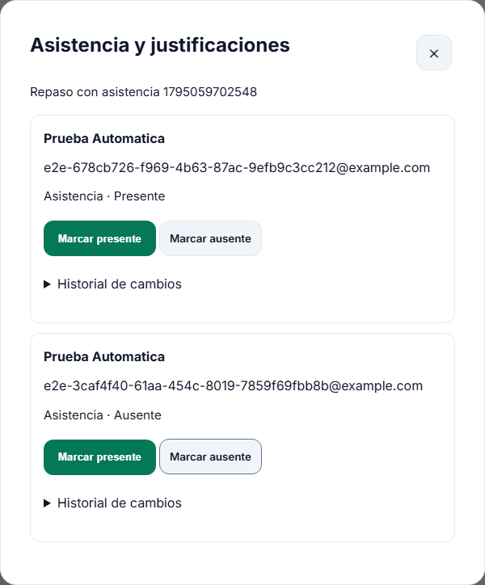
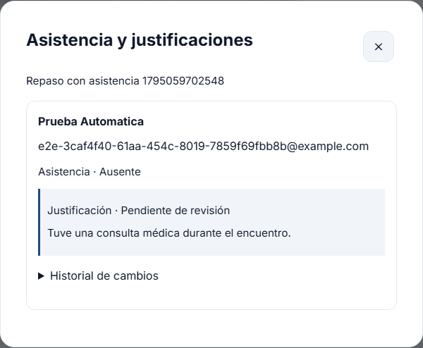
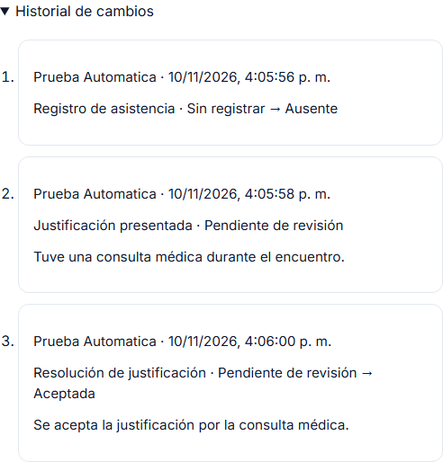
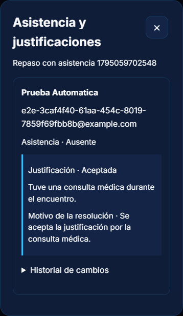
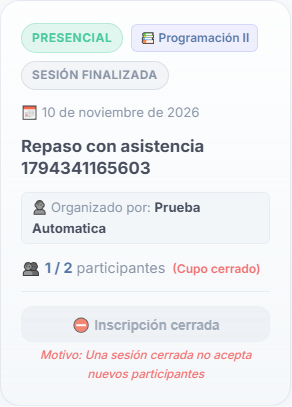

# Tarea 8 — Asistencia y justificaciones

Integrante Jose Brayan Gonzales Alba.

Proyecto StudyMatch. Implementación del 10 de noviembre de 2026.

## Funcionalidad asignada

Al terminar una sesión, el organizador registra presentes o ausentes entre sus participantes confirmados. Cada participante consulta su resultado. Una persona ausente puede presentar una justificación y el organizador la acepta o rechaza indicando el motivo. Se conserva el historial de cambios.

La demostración solicitada incluye presentes, ausentes, una justificación resuelta y el bloqueo de modificaciones por un usuario ajeno.

## Revisión de los archivos y decisiones

La aplicación ya utiliza `models.py` para sus tablas, `schemas.py` para validar datos y `routers/sessions.py` para las acciones sobre sesiones. El Dashboard contiene las tarjetas y los formularios relacionados. Se eligió ampliar esos archivos y reutilizar el bloqueo de sesiones, los permisos y el reconocimiento de participantes confirmados que ya se utilizaban en las tareas anteriores.

La sesión tiene fecha y hora de inicio. Para registrar que el encuentro terminó, se agregó **Finalizar sesión y registrar asistencia**. El organizador puede finalizar una sesión de hoy o de una fecha anterior. Se requiere resolver las reconfirmaciones pendientes antes de finalizar.

Al finalizar se guarda la fecha de cierre, se cierran las inscripciones y se registra quiénes estaban confirmados. La finalización protege esa lista y los registros posteriores frente a retiradas, cambios generales, reprogramaciones y eliminación de la sesión. Una solicitud en espera o pendiente queda fuera del registro de asistencia.

La asistencia comienza en **Sin registrar**. El organizador puede marcar **Presente** o **Ausente** y corregir esa marca mientras la persona todavía carezca de una justificación presentada. Cada cambio de marca queda guardado.

Se permite una justificación por ausencia. Su texto admite entre 3 y 2000 caracteres. El organizador debe indicar un motivo de entre 3 y 1000 caracteres al aceptarla o rechazarla. Después de presentar una justificación, las correcciones de asistencia quedan bloqueadas para conservar la relación entre la ausencia, el texto presentado y su resolución.

Aceptar la justificación conserva la marca **Ausente** y muestra **Justificación aceptada** junto al motivo. El registro distingue lo ocurrido en el encuentro de la evaluación de la explicación presentada.

## Datos y estados

| Dato | Almacenamiento | Propósito |
| --- | --- | --- |
| Momento de finalización | `sessions.finished_at` | Identifica una sesión finalizada y protege su registro de participantes. |
| Asistencia por participante | `session_attendance` | Relaciona una sesión con una cuenta y guarda su marca, justificación, estado de revisión y motivo. |
| Historial de cambios | `attendance_history` | Guarda quién hizo cada cambio, cuándo, el estado anterior, el nuevo y el texto correspondiente. |

La restricción única de sesión y participante evita duplicar la asistencia. Las relaciones de base de datos protegen los registros de asistencia y su historial frente a eliminación. Al iniciar el backend se crean las dos tablas y se añade `finished_at` a la base PostgreSQL existente.

| Acción | Estado resultante |
| --- | --- |
| Finalizar la sesión | Asistencia sin registrar para cada participante confirmado. |
| Marcar presencia | Presente. |
| Marcar ausencia | Ausente. |
| Enviar justificación | Justificación pendiente de revisión. |
| Aceptar con motivo | Justificación aceptada. |
| Rechazar con motivo | Justificación rechazada. |

Repetir la misma marca de asistencia devuelve el resultado actual. Repetir una justificación o resolver una que ya tiene decisión devuelve HTTP 409. Las escrituras bloquean la fila de la sesión durante la transacción, por lo que las validaciones y el cambio se aplican en orden incluso ante solicitudes concurrentes.

## Permisos y acceso desde la aplicación

El organizador accede a **Registrar asistencia** desde la tarjeta de su sesión. El botón se habilita para sesiones de hoy o anteriores. Primero confirma la finalización y luego ve a los participantes registrados, con las acciones de marcar presencia o ausencia y resolver justificaciones pendientes.

El participante accede a **Consultar mi asistencia** desde la tarjeta de la sesión finalizada. Puede encontrarla en Mis solicitudes o en Todas las sesiones. El resultado muestra exclusivamente su propio registro. Si figura ausente, encuentra el formulario **Justifica tu ausencia**.

El acceso a los resultados se reconoce mediante el identificador de la cuenta. Se admiten participaciones antiguas guardadas por correo y cambios posteriores de correo de perfil. La comprobación de permisos también se realiza en el servidor, utilizando la cuenta autenticada.

| Actor | Consulta | Modificación |
| --- | --- | --- |
| Organizador | Todos los registros de su sesión. | Marca asistencia y acepta o rechaza justificaciones con motivo. |
| Participante registrado | Su resultado y su historial. | Presenta su propia justificación cuando figura ausente. |
| Usuario ajeno o solicitante en espera | Acceso bloqueado a los registros de asistencia. | Intento de modificación rechazado. |

## Archivos afectados

| Archivo | Responsabilidad |
| --- | --- |
| `backend/app/models.py` | Finalización, tablas de asistencia y cambios. |
| `backend/app/schemas.py` | Validación de estados y textos, respuestas de la API. |
| `backend/app/routers/sessions.py` | Finalizar, consultar, registrar, justificar y resolver. Permisos y transacciones. |
| `backend/app/rescheduling.py` | Validación de la reprogramación frente a una sesión finalizada. |
| `backend/app/history.py` | Presentación de una sesión finalizada en el historial general. |
| `backend/app/triggers.py` | Adición de la columna de finalización a la base existente. |
| `frontend/src/pages/Dashboard.jsx` | Accesos en las tarjetas y formularios de asistencia y justificación. |
| `frontend/src/styles/Dashboard.css` | Presentación del diálogo en escritorio, móvil y ambos temas. |
| `backend/tests/test_attendance.py` | Siete pruebas de reglas, permisos, historial, datos antiguos y validaciones. |
| `tests/apoyo.js` | Fecha configurable para preparar sesiones de hoy mediante el formulario existente. |
| `tests/asistencia.spec.js` | Dos pruebas E2E del recorrido y de una restricción de permisos. |

## Recorrido y capturas

Se preparó una sesión de hoy con dos estudiantes confirmados, utilizando cuentas ficticias independientes y los formularios reales de la aplicación.

1. El organizador finalizó la sesión y marcó un participante presente y otro ausente.
2. Cada estudiante consultó su propio resultado desde Mis solicitudes.
3. La persona ausente presentó una justificación, que quedó pendiente.
4. El organizador volvió a entrar, escribió el motivo y aceptó la justificación.
5. La persona ausente recargó y comprobó la resolución y el motivo.
6. Se revisó el historial y la presentación en móvil y modo oscuro.









En otra prueba, un usuario ajeno buscó la sesión finalizada. Se comprobó la ausencia de controles de asistencia para esa cuenta. Después se intentó modificar la marca mediante una petición autenticada con su cuenta y otra con la del participante. Ambos intentos devolvieron **HTTP 403**. Al recargar como organizador, la marca seguía presente y el historial mantenía un solo cambio.



## Pruebas y resultados

Las dos pruebas nuevas de navegador pasaron en Chromium durante la primera comprobación, en 2,2 minutos. La suite completa terminó con **35 de 35 pruebas aprobadas en Chromium en 5,9 minutos**, incluida la versión final de los casos de asistencia y los recorridos de las tareas anteriores.

Las **61 pruebas del backend pasaron**, incluidas siete nuevas. Cubren el recorrido, aceptación y rechazo, privacidad, usuarios ajenos, valores inválidos, repeticiones, correcciones, participantes antiguos y finalización con reconfirmaciones pendientes. La ejecución utiliza SQLite aislado. Emitió cuatro avisos de deprecación de dependencias y configuración existentes.

La compilación del frontend con `npm run build` pasó. Las capturas se revisaron en escritorio y móvil. Las pruebas E2E utilizan PostgreSQL local y crean sus propias cuentas y sesiones, cuyos datos permanecen disponibles al terminar.

### Comandos de repetición

Con backend y frontend en ejecución, desde la raíz del proyecto

```powershell
pnpm exec playwright test tests/asistencia.spec.js --project=chromium --workers=1 --reporter=line --trace=off
```

Para ejecutar la suite de navegador completa

```powershell
pnpm exec playwright test --project=chromium --workers=1 --reporter=line --trace=off
```

Desde la carpeta `backend`, con el entorno virtual preparado

```powershell
.\venv\Scripts\python.exe -m pytest -q
```

## Commit

[Ver commit de la tarea 8 df95b14](https://github.com/BrayanG123/2do_Proyeccto_IHC/commit/df95b143856372a5d5f393e0c771a2fec186f013), con el mensaje `registrar asistencia y resolver justificaciones de sesiones`.
