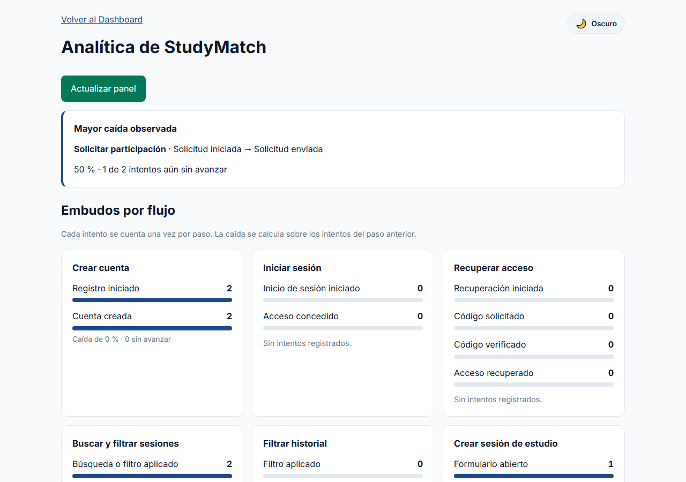
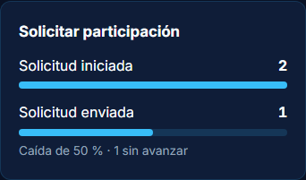

# Tarea 9 — Analítica y cancelación de sesiones

Proyecto StudyMatch. Integrante Jose Brayan Gonzales Alba.

## Parte A — Mapa de recorridos

Los pasos entre corchetes indican dónde se registra un evento. El inicio es la primera acción con intención de completar la tarea. El éxito se registra al confirmar el resultado.

| Pantalla o recorrido | Puntos de medición |
| --- | --- |
| Registro | Formulario [inicio al introducir datos] → Dashboard [cuenta creada]. |
| Inicio de sesión | Formulario [inicio al introducir datos] → Dashboard [credenciales aceptadas]. |
| Recuperar acceso | Formulario de correo [inicio] → Código [enviado] → Contraseña [código verificado] → [acceso recuperado, con contraseña nueva o con código]. |
| Dashboard y Mis solicitudes | Búsqueda o filtros activos [consulta] → [con resultados] o [sin resultados]. |
| Historial | Filtro por actividad [filtro aplicado] → [con resultados] o [sin resultados]. |
| Crear, editar y eliminar sesión | Formulario o confirmación [inicio] → tarjeta actualizada o retirada [cambio guardado]. |
| Cerrar inscripciones | Acción en la tarjeta [inicio] → estado cerrado [cambio guardado]. |
| Solicitar participación | Confirmación [inicio] → estado pendiente [solicitud enviada]. |
| Gestionar solicitudes | Diálogo de gestión [inicio] → [decisión guardada, incluida la entrada a lista de espera]. |
| Retirarse de una sesión | Acción en la tarjeta [inicio] → [participación retirada]. |
| Reprogramar y reconfirmar | Formulario del organizador [inicio] → [reprogramación guardada]. Acción del participante [inicio] → [reconfirmación guardada]. |
| Asistencia | Diálogo del organizador [inicio de finalización] → [sesión finalizada]. Acción de marcar [inicio] → [marca guardada]. |
| Justificar ausencia | Formulario del participante [inicio al escribir] → [justificación enviada]. Formulario del organizador [inicio al escribir] → [resolución guardada]. |
| Editar perfil | Formulario [inicio] → perfil actualizado [datos guardados]. |
| Cancelar sesión | Confirmación del organizador [inicio] → sesión cancelada [cambio guardado]. |

Los errores de validación, permisos, estados incompatibles y otros fallos que impiden avanzar se cuentan por recorrido y código fijo. El contenido de los formularios, los filtros y los mensajes del servidor queda fuera de la analítica.

### Plan de eventos

| Flujo | Evento | Archivo y línea | Pregunta |
| --- | --- | --- | --- |
| Crear cuenta | `registro_iniciado` → `cuenta_creada` | [Register.jsx:20](../frontend/src/pages/Register.jsx#L20) · [auth.py:66](../backend/app/routers/auth.py#L66) | ¿Cuántos registros llegan a crear una cuenta? |
| Iniciar sesión | `acceso_iniciado` → `acceso_concedido` | [Login.jsx:14](../frontend/src/pages/Login.jsx#L14) · [auth.py:91](../backend/app/routers/auth.py#L91) | ¿Cuántos intentos consiguen acceso? |
| Recuperar acceso | `recuperacion_iniciada` → `codigo_enviado` → `codigo_verificado` → `acceso_recuperado` | [ForgotPassword.jsx:29](../frontend/src/pages/ForgotPassword.jsx#L29) · [auth.py:104](../backend/app/routers/auth.py#L104), [155](../backend/app/routers/auth.py#L155), [186](../backend/app/routers/auth.py#L186), [228](../backend/app/routers/auth.py#L228) | ¿Se interrumpe el recorrido al pedir el código, al verificarlo o al recuperar el acceso? |
| Buscar sesiones | `busqueda_iniciada` → `busqueda_con_resultados` o `busqueda_sin_resultados` | [Dashboard.jsx:149](../frontend/src/pages/Dashboard.jsx#L149), [168](../frontend/src/pages/Dashboard.jsx#L168) | ¿Cuántas búsquedas o filtros devuelven sesiones en la vista actual? |
| Filtrar historial | `historial_filtro_aplicado` → `historial_con_resultados` o `historial_sin_resultados` | [History.jsx:133](../frontend/src/pages/History.jsx#L133) | ¿Cuántos filtros encuentran actividad del tipo elegido? |
| Crear sesión | `creacion_iniciada` → `sesion_creada` | [Dashboard.jsx:280](../frontend/src/pages/Dashboard.jsx#L280) · [sessions.py:30](../backend/app/routers/sessions.py#L30) | ¿Cuántos formularios abiertos terminan guardándose? |
| Solicitar participación | `solicitud_iniciada` → `solicitud_enviada` | [Dashboard.jsx:390](../frontend/src/pages/Dashboard.jsx#L390) · [analytics.py:19](../backend/app/routers/analytics.py#L19) · [sessions.py:324](../backend/app/routers/sessions.py#L324) | ¿Cuántas aperturas del diálogo terminan en una solicitud guardada? |
| Gestionar solicitudes | `gestion_iniciada` → `decision_guardada` | [Dashboard.jsx:481](../frontend/src/pages/Dashboard.jsx#L481), [495](../frontend/src/pages/Dashboard.jsx#L495) · [sessions.py:457](../backend/app/routers/sessions.py#L457) | ¿Cuántos intentos terminan con una decisión guardada, incluida la lista de espera? |
| Editar sesión | `edicion_iniciada` → `sesion_editada` | [Dashboard.jsx:288](../frontend/src/pages/Dashboard.jsx#L288) · [sessions.py:203](../backend/app/routers/sessions.py#L203) | ¿Cuántas ediciones llegan a guardarse? |
| Cerrar inscripciones | `cierre_iniciado` → `inscripciones_cerradas` | [Dashboard.jsx:450](../frontend/src/pages/Dashboard.jsx#L450) · [sessions.py:99](../backend/app/routers/sessions.py#L99) | ¿Cuántos intentos consiguen cerrar inscripciones? |
| Retirarse | `retiro_iniciado` → `participacion_retirada` | [Dashboard.jsx:510](../frontend/src/pages/Dashboard.jsx#L510) · [sessions.py:491](../backend/app/routers/sessions.py#L491) | ¿Cuántos intentos terminan con la salida del participante? |
| Reprogramar | `reprogramacion_iniciada` → `reprogramacion_guardada` | [Dashboard.jsx:384](../frontend/src/pages/Dashboard.jsx#L384) · [sessions.py:528](../backend/app/routers/sessions.py#L528) | ¿Cuántos formularios terminan con la nueva fecha guardada? |
| Reconfirmar | `reconfirmacion_iniciada` → `participacion_reconfirmada` | [Dashboard.jsx:522](../frontend/src/pages/Dashboard.jsx#L522) · [sessions.py:538](../backend/app/routers/sessions.py#L538) | ¿Cuántas reconfirmaciones iniciadas se guardan? |
| Finalizar para tomar asistencia | `finalizacion_iniciada` → `sesion_finalizada` | [Dashboard.jsx:537](../frontend/src/pages/Dashboard.jsx#L537) · [sessions.py:581](../backend/app/routers/sessions.py#L581) | ¿Cuántas aperturas de asistencia concluyen con la sesión finalizada? |
| Marcar asistencia | `marca_iniciada` → `asistencia_registrada` | [Dashboard.jsx:576](../frontend/src/pages/Dashboard.jsx#L576) · [sessions.py:617](../backend/app/routers/sessions.py#L617) | ¿Cuántas marcas solicitadas quedan confirmadas? |
| Justificar ausencia | `justificacion_iniciada` → `justificacion_enviada` | [Dashboard.jsx:567](../frontend/src/pages/Dashboard.jsx#L567) · [sessions.py:636](../backend/app/routers/sessions.py#L636) | ¿Cuántas justificaciones iniciadas se envían? |
| Resolver justificación | `resolucion_iniciada` → `justificacion_resuelta` | [Dashboard.jsx:572](../frontend/src/pages/Dashboard.jsx#L572) · [sessions.py:655](../backend/app/routers/sessions.py#L655) | ¿Cuántas revisiones terminan con una resolución? |
| Editar perfil | `perfil_edicion_iniciada` → `perfil_actualizado` | [Profile.jsx:47](../frontend/src/pages/Profile.jsx#L47) · [auth.py:296](../backend/app/routers/auth.py#L296) | ¿Cuántas ediciones del perfil se guardan? |
| Eliminar sesión | `eliminacion_iniciada` → `sesion_eliminada` | [Dashboard.jsx:378](../frontend/src/pages/Dashboard.jsx#L378) · [sessions.py:268](../backend/app/routers/sessions.py#L268) | ¿Cuántas aperturas de la confirmación terminan en eliminación? |
| Cancelar sesión (Parte B) | `cancelacion_iniciada` → `sesion_cancelada` | [analytics_events.py](../backend/app/analytics_events.py) · [analytics_tracking.py:19](../backend/app/analytics_tracking.py#L19) | ¿Cuántos intentos del organizador terminan en una cancelación? |
| Bloqueos del flujo | `<flujo>_bloqueo` | [analytics.py:52](../backend/app/routers/analytics.py#L52) · [analytics_tracking.py:106](../backend/app/analytics_tracking.py#L106) | ¿Qué validación, permiso u otro bloqueo impide avanzar? |

### Datos y panel

El navegador crea un UUID aleatorio por intento. La tabla `analytics_events` guarda ese identificador, el evento, la fecha, un motivo predefinido si hubo un bloqueo y la modalidad controlada en solicitudes. Quedan fuera los identificadores de cuenta, correos, nombres, consultas, claves, códigos de recuperación y textos de motivos o justificaciones. Cada evento de paso se guarda una sola vez por intento. Los bloqueos recibidos del servidor cuentan cada rechazo. Una validación del formulario se cuenta una vez por intento.

Los éxitos se registran después de una respuesta satisfactoria del servidor. El envío de solicitudes conserva el evento en la misma transacción que la solicitud. En recuperación, «Código solicitado» significa que se generó el código y se programó el envío. Las búsquedas se registran una vez por cambio de filtros aplicado, con el resultado de la vista actual.

El panel privado [`/analitica`](../frontend/src/pages/Analytics.jsx) muestra los embudos y los últimos eventos con hora de Bolivia. Cada paso cuenta solo los intentos que también tienen todos los pasos anteriores. La caída es la diferencia de conteos dividida entre el conteo del paso anterior. Un intento en curso también puede aparecer en la caída hasta que avance.

Los eventos de Clase 21 se conservan en la base de datos, en los últimos eventos cuando corresponda y en `GET /analytics/summary`. Los embudos de `GET /analytics/funnels` empiezan con los intentos que tienen UUID.

El embudo de cancelación queda definido en esta parte. La Parte B deberá llamar a `startFlow('cancelar_sesion')` al abrir la confirmación y adjuntar `attemptConfig(attempt)` al `POST /sessions/{session_id}/cancel` para activar la medición.

### Mayor caída observada

En una base de prueba limpia, se abrieron dos solicitudes de participación y se completó una. La mayor caída de ese escenario fue **50 % entre iniciar y enviar la solicitud**. Se cerró el primer diálogo a propósito para comprobar el cálculo. Con un patrón similar en uso real, probaría mover el aviso de aprobación justo encima de «Enviar solicitud» para que se lea al confirmar, sobre todo en móvil. Compararía la proporción de envíos antes y después.





### Verificación

- **Backend:** 70 pruebas aprobadas. Las pruebas de analítica cubren reintentos, correlación de intentos, registros de Clase 21, privacidad y los pasos de recuperación con entrega de correo simulada.
- **Navegador:** 37 pruebas aprobadas en Chromium sobre PostgreSQL aislado. Se verificaron los eventos de los recorridos principales, la validación, el permiso denegado, los filtros sin resultados y la persistencia al recargar el panel.
- **Recuperación de acceso:** una prueba adicional en Chromium con correo simulado registró los cuatro pasos del mismo intento. Se corrigió la comparación del vencimiento para aceptar códigos vigentes cuando PostgreSQL devuelve la fecha en hora de Bolivia. [auth.py:147](../backend/app/routers/auth.py#L147)
- **Migración:** se aplicó dos veces sobre una base de prueba con el esquema de Clase 21. Los eventos previos se conservaron y los nuevos embudos contaron los intentos correctamente.
- **Frontend:** la compilación pasó y se comprobó el panel en escritorio y móvil con tema oscuro.

Para repetir las pruebas del backend desde `backend`

```powershell
.\venv\Scripts\python.exe -m pytest -q
```

Para repetir las pruebas de navegador desde la raíz, con el backend y el frontend en ejecución

```powershell
pnpm exec playwright test --project=chromium --workers=3 --reporter=line --trace=off
```
